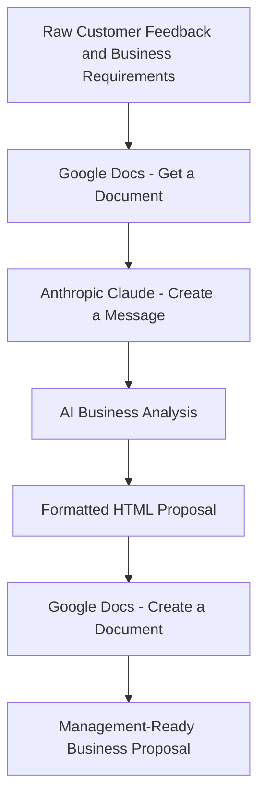

# AI-Powered Business Proposal Generator

## Project Overview

An AI-powered document automation solution designed to
transform raw customer feedback, business problems, and
requirements into professionally formatted business proposals.

This project integrates Make.com, Anthropic Claude, and
Google Docs to automate business analysis, document
generation, and management reporting.

Developed using Northstar Cloud Solutions, a fictional B2B
software provider, the project demonstrates how generative
AI can support business analysts, customer success teams,
and organizational decision-making.

## Business Problem

Organizations spend significant time reviewing customer
feedback, gathering business requirements, identifying
operational challenges, and preparing management-ready
business proposals.

These manual processes can lead to:

- Time-consuming document preparation
- Inconsistent proposal formatting
- Delayed business analysis
- Difficulty identifying recurring customer concerns
- Increased administrative workload
- Inconsistent business recommendations
- Delayed management decisions

## The Solution

This project automates the process of transforming raw
business information into a structured business proposal.

Make retrieves the source document from Google Docs and
passes the content to Anthropic Claude for analysis.

Claude identifies business challenges, evaluates their
operational impact, recommends practical solutions, and
generates a professionally formatted HTML document.

The workflow automatically creates a separate Google Doc
containing the completed business proposal with a
standardized file name and generation date.

## Technology Stack

| Technology | Purpose |
|---|---|
| Make.com | Workflow automation and orchestration |
| Anthropic Claude | AI-powered business analysis and document generation |
| Claude Haiku 5.5 | AI model configured in the exported blueprint |
| Google Docs | Source document retrieval and proposal generation |
| Google Drive | Document storage and organization |
| HTML | Professional document formatting |
| JSON | Workflow configuration and data exchange |

## Workflow Architecture



## How It Works

### 1. Source Document Retrieval - Google Docs

The workflow retrieves an existing Google Doc containing
raw customer feedback, business requirements, or
operational challenges.

For this demonstration, the source document contains
20 synthetic customer feedback submissions for
Northstar Cloud Solutions.

Feedback is collected from three channels:

- Customer surveys
- Onboarding surveys
- Support ticket follow-ups

Each feedback entry includes a unique identifier,
submission date, feedback source, and customer comments.

### 2. AI Business Analysis - Anthropic Claude

The source document content is dynamically mapped
into a structured Claude prompt.

Claude is instructed to act as an experienced business
analyst and evaluate the information provided.

The AI performs several analytical tasks:

- Identifies recurring business challenges
- Evaluates customer concerns and positive experiences
- Identifies operational inefficiencies
- Assesses potential business impacts
- Recommends technology and process improvements
- Develops an implementation plan
- Identifies risks and mitigation strategies
- Recommends actionable next steps

The prompt instructs Claude to avoid inventing facts,
financial costs, or performance metrics that are not
supported by the source information.

### 3. Prompt Engineering and Document Formatting

A structured prompt controls both the analytical
requirements and the document presentation.

Claude is instructed to generate the proposal using
professional HTML formatting rather than Markdown.

Formatting requirements include:

- Clear document titles and section headings
- Consistent spacing and layout
- Professional business language
- Structured paragraphs and bullet points
- Bold text for important information
- Tables where they improve readability
- Concise implementation and risk details
- Management-ready document formatting

The AI returns only the formatted HTML document
content without additional explanations or code fences.

### 4. Automated Document Generation - Google Docs

The final Make module receives the AI-generated HTML
content and creates a new Google Doc.

The completed proposal is stored in a designated
Google Drive folder.

The original source document remains unchanged.

The workflow also generates a standardized document
name containing the company name and current date.

Example file name:

Northstar Cloud Solutions - Business Proposal - 11-21-2026

Dynamic date expression:

```text
{{formatDate(now; "MM-DD-YYYY")}}
```

This provides a consistent naming convention and
supports historical document tracking.

## Business Proposal Structure

Each generated proposal follows a standardized
business analysis framework.

| Section | Purpose |
|---|---|
| Executive Summary | Summarizes the business problem and proposed solution |
| Business Problem | Identifies operational challenges and their impact |
| Proposed Solution | Recommends technology and process improvements |
| Implementation Plan | Defines implementation phases and responsibilities |
| Expected Benefits | Explains potential operational and business improvements |
| Risks and Challenges | Identifies potential obstacles and mitigation strategies |
| Next Steps | Recommends actions for the next 30 days |

## Demonstration Company

**Company:** Northstar Cloud Solutions

**Industry:** B2B Software and Technology Services

**Business Functions:**

- Customer onboarding
- Software implementation
- Customer support
- System integrations
- Business reporting
- Customer success management

**Dataset:** 20 synthetic customer feedback submissions

**Reporting Period:** November 2–13, 2026

The demonstration evaluates customer feedback to identify
opportunities for operational improvement and improved
customer satisfaction.

## Example Business Findings

The generated proposal identified several operational
challenges from the customer feedback dataset.

| Business Challenge | Potential Business Impact |
|---|---|
| Onboarding delays | Extended time-to-value |
| Training gaps | Reduced user adoption and productivity |
| Recurring data synchronization errors | Reporting delays and operational disruption |
| Inconsistent support handoffs | Increased customer effort |
| Outdated documentation | Increased dependency on support teams |
| Unresolved feature requests | Reduced customer engagement |
| System performance issues | Reduced operational efficiency |

The proposal also identified positive customer experiences,
including responsive customer support, useful automated
reports, successful data migrations, and effective dashboards.

## Example Implementation Plan

The generated proposal includes a phased approach
to implementing business improvements.

| Phase | Key Objective |
|---|---|
| Preparation | Standardize feedback sources and reporting requirements |
| Workflow Configuration | Configure automated feedback analysis |
| Validation | Compare AI outputs against manually reviewed feedback |
| Pilot Operation | Evaluate the workflow during a feedback reporting cycle |
| Full Rollout | Establish a recurring reporting and review process |
| Continuous Improvement | Refine prompts, categories, and escalation criteria |

These phases are recommendations generated within the
sample business proposal, not additional automation
modules implemented in the current workflow.

## Input and Output

### Input

The source document contains:

- Business context
- Customer feedback
- Submission identifiers
- Submission dates
- Feedback sources
- Operational concerns
- Positive customer experiences

### Processing

Anthropic Claude transforms the source information into:

- Business problem analysis
- Operational impact assessment
- Proposed solutions
- Implementation recommendations
- Expected business benefits
- Risk mitigation strategies
- Actionable next steps

### Output

A professionally formatted Google Doc containing
a complete business proposal ready for management review.

## Key Features

- Automated source document retrieval
- AI-powered business analysis
- Customer feedback evaluation
- Automated business proposal generation
- Dynamic data mapping
- Professional HTML formatting
- Automated Google Docs creation
- Date-based document naming
- Centralized document storage
- Standardized management reporting
- Reusable business analysis prompts
- Source-grounded AI recommendations

## Business Benefits

- Reduces manual business proposal preparation
- Improves consistency across business documents
- Supports faster management reporting
- Helps identify recurring operational challenges
- Improves visibility into customer feedback
- Reduces repetitive document formatting tasks
- Supports data-driven business decisions
- Improves scalability of business analysis activities
- Allows analysts to focus on higher-value work

Actual cost savings and productivity improvements
would need to be measured during a production pilot.

## Business Applications

This workflow can be adapted to support multiple
industries and business functions, including:

- Business analysis
- Customer experience management
- Customer success operations
- ERP and software implementations
- Business process improvement
- Change management
- Project management
- Operational assessments
- IT consulting
- Digital transformation
- Internal management reporting
- Business requirements documentation
- Quality management

## Repository Contents

| File | Description |
|---|---|
| Make JSON Blueprint | Exported three-module automation workflow |
| Northstar - Raw Customer Feedback - Master Data.docx | Source dataset containing 20 synthetic feedback submissions |
| Northstar Cloud Solutions - Business Proposal - 11-21-2026.docx | Example AI-generated business proposal |
| README.md | Project documentation and configuration instructions |

## Installation and Configuration

1. Download the Make JSON blueprint from this repository.
2. Log in to Make.com.
3. Create a new scenario.
4. Select Import Blueprint.
5. Upload the JSON blueprint.
6. Connect your Google account.
7. Connect your Anthropic Claude account.
8. Create or upload a source document in Google Docs.
9. Configure the Get a Document module.
10. Select the appropriate Claude model.
11. Configure the business analysis prompt.
12. Map the source document content into Claude.
13. Configure the Create a Document module.
14. Map the AI-generated HTML response.
15. Configure the document naming convention.
16. Select the destination Google Drive folder.
17. Run the scenario and validate the generated proposal.

## Prerequisites

- Make.com account
- Anthropic Claude API access
- Google Docs account
- Google Drive account
- Configured Google and Anthropic connections
- Source document containing business information

Users must configure their own connections, document
identifiers, destination folders, and available AI model
after importing the blueprint.

## Testing and Validation

The project demonstrates the following validation activities:

- Source document retrieval
- Dynamic document content mapping
- AI prompt configuration
- Business feedback analysis
- HTML output generation
- Document formatting
- Automated Google Docs creation
- Dynamic file naming
- End-to-end workflow execution

The repository includes both the original source dataset
and an example generated business proposal, allowing
users to compare the input and output.

## Current Limitations

- AI-generated recommendations require human review.
- Analysis quality depends on source document quality.
- Large documents may require additional token capacity
  or document segmentation.
- The current workflow uses a predefined source document.
- The company name is configured directly in the
  output file naming convention.
- No automated approval or distribution process is
  included in the current blueprint.

## Future Enhancements

- Google Drive folder monitoring
- Automated processing of newly uploaded documents
- Dynamic company name extraction
- PDF and Microsoft Word document processing
- Automated presentation generation using Google Slides
- Email distribution to management teams
- Automated approval workflows
- Historical customer sentiment analysis
- CRM integration with HubSpot or Salesforce
- Power BI reporting integration
- AI-generated financial impact assessments
- Multi-document business analysis
- Custom proposal templates by department
- Automated document quality validation
- Advanced error handling and retry mechanisms

## Security and Data Privacy

The demonstration uses synthetic customer feedback
rather than confidential customer records.

Production implementations should include appropriate
data privacy controls, restricted document access,
secure API credential management, and human review
of AI-generated business recommendations.

Never publish API keys, authentication credentials,
or confidential business documents in a public repository.

## Skills Demonstrated

- AI Automation
- Generative AI
- Anthropic Claude
- Prompt Engineering
- Business Analysis
- Business Requirements Analysis
- Business Process Automation
- Automated Document Generation
- HTML Formatting
- JSON Data Mapping
- Workflow Design and Orchestration
- Google Workspace Integration
- Customer Feedback Analysis
- Business Process Improvement
- Operational Decision Support
- Management Reporting
- Digital Transformation
- Low-Code/No-Code Development

## Project Status

Portfolio demonstration and proof of concept.

This project demonstrates how generative AI and
workflow automation can support business analysts
by transforming raw business information into
structured, actionable, and professionally formatted
management documents.

## Author

**Mark Davis**

AI Automation | Business Systems | ERP & Systems Integration
